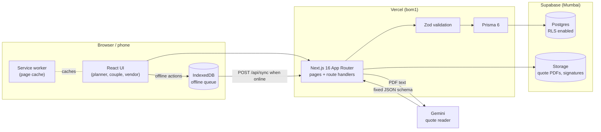
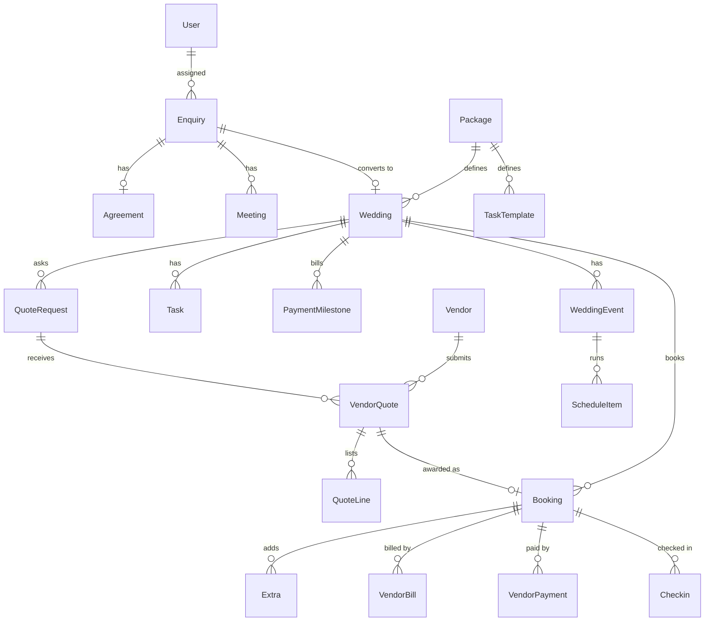

# KnotOS — The Royal Knot

**One system that carries a wedding from the first enquiry to the final vendor payment, and rolls the whole season up for the founder.**

**Live:** https://knotos.vercel.app

| Demo login | Email | Password | Lands on |
|---|---|---|---|
| Founder | `founder@royalknot.in` | `knot@2026` | Season dashboard |
| Planner | `ananya@royalknot.in` | `knot@2026` | Weddings |

Couple and vendor screens need no login; they open from private links created inside the app.

---

## The problem

A wedding-planning firm runs 25 weddings a season on WhatsApp threads, PDFs and spreadsheets. Enquiries get lost, every wedding's checklist is copied from the last one, three caterer quotes arrive in three formats, venue signal drops on the wedding day, and nobody knows which wedding actually made money until the season is over.

## The idea

**Enter data once, it flows everywhere.** An enquiry becomes an agreement, the agreement becomes a wedding with a payment plan, the first payment generates the task plan, the awarded quote becomes a booking, day-of check-ins become vendor scorecards, and all of it lands in the founder's profit view. Nobody re-types anything.

---

## Features by scene

### 1. Enquiry and agreement
**Planner / couple:** the couple fills the public form on their phone (`/enquire`), or a planner quick-adds an enquiry from a call or Instagram. The planner works the enquiry on a drag-and-drop board, books a meeting, sends an agreement and converts the enquiry to a wedding.
**Automatic:**
- Saved immediately with a reference number; assigned to the planner with the fewest open enquiries; follow-up set for the next day.
- Booking a meeting moves the card to *Meeting booked*; no follow-up for 48 hours shows a warning.
- The agreement is generated from the enquiry details and frozen. The couple signs with a finger on their phone; the signature, name, time and IP are stored and the card moves to *Signed*. Signing is the only way to unlock conversion.
- Converting creates the wedding (e.g. `RK-2026-014`), a private couple portal link and three payment milestones (Booking, Advance, Final).
- Every change is written to an activity timeline.

Routes: `/enquire`, `/enquiries`, `/p/sign/[token]`

### 2. Vendor quotes and AI comparison
**Planner:** creates a quote request (e.g. catering for 400 guests) and invites vendors. Each vendor gets a private link to upload a PDF quote or type line items. The planner reviews the extracted data, compares vendors side by side and clicks **Choose**.
**Automatic:**
- The Gemini-powered quote reader turns differently formatted PDFs into one fixed structure (items, per-plate price, extra-hour charge, taxes).
- Comparison shows line by line, price per plate and total for the guest count; the cheapest is highlighted and missing items are flagged.
- Awarding runs in one database transaction: the winner becomes a booking linked to the wedding and the other requests close.

Routes: `/weddings/[id]/quotes`, `/weddings/[id]/quotes/[category]`, `/v/[token]`

### 3. Instant wedding plan
**Planner:** marks the booking payment as paid.
**Automatic:** 25+ tasks are generated from the package template (Full-Service or Partial / Day-of), grouped by phase, each with an owner and a due date counted back from the wedding date. Tasks live on a board (To plan, In progress, Waiting, Done); overdue tasks turn red and progress shows on the wedding card. The couple sees their payment schedule and progress in their portal.

Routes: `/weddings`, `/weddings/[id]` (Overview, Plan, Vendors, Payments tabs), `/p/[token]`

### 4. Wedding-day control room (offline + QR)
**Planner at the venue (phone):** follows a minute-by-minute run sheet with a live now-line, checks vendors in by scanning their QR pass at the gate or tapping *Arrived*, and logs issues with an owner.
**Automatic:**
- Expected vs actual arrival is stored; vendors not checked in by their expected time turn red ("LATE +12 min") with a call button and their backup vendor.
- **Works offline.** Check-ins, run-sheet status changes and issues are written to IndexedDB first, then synced to `/api/sync` when the connection returns. Each action has a UUID `clientId`, so retries and multiple tabs never create duplicates.
- A service worker caches the control-room pages so they open without signal.

Routes: `/weddings/[id]/live`, `/weddings/[id]/live/qr`

### 5. Settlement and extras
**Planner / founder:** adds extras (e.g. +60 guests at the per-plate rate, +2 DJ hours), enters each vendor's final bill and records payments.
**Automatic:**
- Extra costs are calculated from the agreed rates; billable extras go on a client add-on bill that the couple approves from their portal.
- Vendor bills are matched against agreed terms plus extras: Matched, Over-billed or Under-billed.
- Remaining balance per vendor = agreed + extras - paid. A payment needs a unique reference and cannot exceed the balance, so double payment is blocked.
- When every balance reaches zero the wedding becomes *Settled*.

Routes: `/weddings/[id]` (Payments and Settlement tabs)

### 6. Founder's season review
**Founder:** opens the dashboard.
**Automatic:**
- Profit per wedding = client payments (package + billed extras) - vendor costs (agreed + extras) - team hours x hourly cost; the formula is shown.
- All weddings in one table (revenue, cost, margin, profit/loss colour); money due in the coming weeks, in from couples and out to vendors.
- Vendor scorecards built from real data: punctuality from day-of check-ins, bill accuracy from bill matching.
- A read-only share link (no login) and a CSV export of the season.

Routes: `/dashboard`, `/vendors`, `/vendors/[id]`, `/share/[token]`, `/api/reports/season.csv`

---

## Who uses it

| Role | Access | Main screens |
|---|---|---|
| **Founder** | Login | Dashboard, plus everything planners see |
| **Planner** | Login | Enquiries, Weddings (Plan / Vendors / Payments / Settlement), Control Room, Vendors |
| **Couple** | Private link, no login | Sign agreement, progress, payment schedule, approve add-on bill |
| **Vendor** | Private link, no login | Submit quote, QR pass for day-of check-in |

---

## Architecture



### Key decisions

- **UUID primary keys** so records and offline actions can be created on a phone without a server round trip. Offline actions carry a stable `clientId`; the server enforces uniqueness inside its transaction.
- **Money in whole rupees** (integers). No floats in storage; fractional AI-extracted amounts are rounded once on save.
- **One Zod schema, two places.** The same validation (Indian mobile numbers, dates, amounts) runs in the forms and in the API handlers.
- **Transactions where state changes together:** awarding a quote (booking created, other requests closed) and recording payments.
- **Unique payment references** (`PaymentMilestone.reference` and vendor payment references are unique in the database), so the same receipt cannot be recorded twice.
- **RLS enabled on every table** (migration `enable_rls`, no policies). The app talks to Postgres through Prisma only, so Supabase's public REST API exposes nothing.
- **Token-based public access.** Agreements, couple portals, vendor quotes, check-ins and share links use unguessable tokens; staff pages require a signed session cookie (`src/proxy.ts`).
- **Quote reader is constrained, not trusted.** It extracts embedded PDF text, requests facts with `null` for unknowns, validates the response against a strict schema (extra keys and negative prices rejected), allows one repair attempt, and always goes through planner review before saving. If the service is unavailable, the three bundled demo PDFs fall back to saved results (matched by text fingerprint; unknown documents never match) and manual entry is always available. See `src/lib/ai/README.md`.

---

## Data model

24 tables in `prisma/schema.prisma`.

| Area | Tables | What they hold |
|---|---|---|
| Staff | `User` | Founder / planner accounts, role, hourly cost |
| Enquiry | `Enquiry`, `Meeting`, `Agreement` | Leads and their source, meetings, frozen agreement text with signature, signer and IP |
| Wedding | `Package`, `TaskTemplate`, `Wedding`, `WeddingEvent` | Package types, task templates, the wedding (code, portal token, contract value), its events (Mehendi, Sangeet, Wedding...) |
| Plan | `Task`, `PaymentMilestone` | Generated tasks with owners and due dates; Booking / Advance / Final milestones with unique payment reference |
| Vendors | `Vendor`, `QuoteRequest`, `VendorQuote`, `QuoteLine`, `Booking` | Directory with backup vendor, requests, per-vendor quotes with line items, awarded bookings |
| Wedding day | `ScheduleItem`, `Checkin`, `Issue` | Run sheet, QR/manual check-ins with arrival times, issues log |
| Settlement | `Extra`, `VendorBill`, `VendorPayment` | Extras, vendor bills and match status, payments against bookings |
| Cross-cutting | `TimeLog`, `ShareLink`, `ActivityLog` | Team hours for profit, read-only share links, audit timeline |



---

## API overview

Own REST route handlers under `src/app/api`. Staff endpoints check the session; `/api/public/*` and token endpoints use unguessable tokens.

| Area | Endpoints |
|---|---|
| Auth | `POST /api/auth/login`, `POST /api/auth/logout` |
| Enquiries | `GET/POST /api/enquiries`, `/api/enquiries/[id]`, `/[id]/meetings`, `/[id]/agreement`, `/[id]/convert` |
| Public (no login) | `POST /api/public/enquiries`, `POST /api/public/agreements/[token]/sign`, `POST /api/public/portal/[token]/approve` |
| Plan and payments | `POST /api/weddings/[id]/generate-plan`, `/api/weddings/[id]/tasks`, `/api/tasks/[id]`, `POST /api/milestones/[id]/pay` |
| Vendors and quotes | `/api/vendors`, `/api/vendors/[id]`, `/api/quote-requests`, `POST /api/quote-requests/[id]/award`, `/api/quotes/[token]` with `/file`, `/extract`, `/review` |
| Control room | `/api/schedule-items/[id]`, `/api/checkins`, `/api/issues`, `/api/issues/[id]`, `POST /api/sync` (offline batch: `CHECKIN`, `SCHEDULE_STATUS`, `ISSUE`) |
| Settlement | `/api/bookings/[id]/extras`, `/bills`, `/payments`, `POST /api/weddings/[id]/addon-bill`, `POST /api/weddings/[id]/settle` |
| Reporting | `POST /api/share-links`, `GET /api/reports/season.csv` |

---

## Tech stack

| Layer | Choice |
|---|---|
| Framework | Next.js 16 (App Router), React 19, TypeScript |
| UI | Tailwind CSS 4, shadcn/ui (Radix), Framer Motion, Recharts, dnd-kit, locally bundled fonts (Inter, Cormorant Garamond) |
| Forms and validation | React Hook Form, Zod 4 |
| Database | PostgreSQL on Supabase (Mumbai), Prisma 6 |
| Auth | Signed session cookie (`jose`), `bcryptjs` password hashes, token links for couples and vendors |
| AI | Google Gemini via `@google/genai` (quote reader), `pdf-parse` for text extraction |
| Offline | Dexie (IndexedDB), service worker (`public/sw.js`) |
| QR and signatures | `qrcode`, `html5-qrcode`, `signature_pad` |
| PDF | `pdf-lib` |
| Testing | Node test runner via `tsx`, `fake-indexeddb` |
| Hosting | Vercel (region `bom1`) |

---

## Getting started locally

**Prerequisites:** Node.js 22+, npm, a Postgres database (a free Supabase project works).

```bash
npm install
cp .env.example .env        # then fill in the values below
npx prisma migrate deploy   # create the schema (and enable RLS)
npm run db:seed             # seed packages, templates, vendors, enquiries, 25 weddings
npm run demo:today          # optional, see below
npm run dev                 # http://localhost:3000
```

### Environment variables

| Variable | Purpose |
|---|---|
| `DATABASE_URL` | Supabase pooler connection (port 6543, with `?pgbouncer=true`), used by the app |
| `DIRECT_URL` | Direct connection (port 5432), used by Prisma migrations |
| `AUTH_SECRET` | 32+ random characters used to sign session cookies |
| `NEXT_PUBLIC_APP_URL` | Base URL used in generated links (`http://localhost:3000` locally) |
| `NEXT_PUBLIC_SUPABASE_URL` | Supabase project URL, for file storage (quote PDFs, signatures) |
| `SUPABASE_SERVICE_ROLE_KEY` | Server-only key for storage uploads; never exposed to the browser |
| `AI_PROVIDER` | Quote reader provider, `gemini` by default |
| `AI_API_KEY` | Server-only API key for the quote reader. Optional: without it the bundled demo PDFs use saved results and other quotes are entered manually |
| `AI_MODEL` | Model name, `gemini-3.1-flash-lite` by default |

### What `npm run demo:today` does
It makes the seeded demo wedding "happen today": shifts all of its event and run-sheet times so the main ceremony started 90 minutes ago, and rebuilds schedule statuses, vendor arrivals, check-ins and issues. The Control Room then shows a live now-line, some vendors already arrived and one running late. It is repeatable; run it again before each demo.

### Other scripts

| Command | Does |
|---|---|
| `npm test` | Unit tests for the AI reader, offline queue and service worker, QR, and seed data |
| `npm run typecheck` | `tsc --noEmit` |
| `npm run lint` | ESLint |
| `npm run build` | Production build |
| `npm run db:reset` | Reset the database and reseed (destructive) |
| `npm run db:studio` | Prisma Studio |
| `npm run quotes` | Regenerate the three demo caterer quote PDFs in `demo-assets/quotes` |

Camera (QR scanning), IndexedDB and the service worker need HTTPS or `localhost`.

---

## Demo script (5 minutes)

1. **Enquiry:** submit `/enquire` from a phone; it appears in the *New* column with an owner and follow-up date.
2. **Agreement:** send the agreement, sign it with a finger on the phone, watch the card move to *Signed*, then convert it to a wedding.
3. **Plan:** mark the booking payment paid; 25+ tasks with owners and due dates appear.
4. **Quotes:** upload the three caterer PDFs from `demo-assets/quotes`, review the extracted data, compare side by side, choose the winner and see the others close.
5. **Control room and money:** with Wi-Fi off, check in a vendor and log an issue; reconnect and watch it sync. Then add extras, block a duplicate payment, and open the founder dashboard for profit, cash due and vendor scorecards.

## Screenshots

<!-- add screenshots -->

---

## Project structure

```
knotos/
├── prisma/
│   ├── schema.prisma        # 24 tables
│   ├── migrations/          # init + enable_rls
│   ├── seed/                # seed entry, demo data, demo-today
│   └── seed-data/           # realistic vendors, schedules, weddings
├── public/sw.js             # offline service worker
├── demo-assets/             # demo caterer quote PDFs and generators
└── src/
    ├── proxy.ts             # session gate for staff pages
    ├── app/
    │   ├── (app)/           # staff app: dashboard, enquiries, weddings, vendors
    │   ├── api/             # REST route handlers
    │   ├── enquire/         # public enquiry form
    │   ├── login/
    │   ├── p/               # couple portal and agreement signing
    │   ├── v/               # vendor portal
    │   └── share/           # read-only share links
    ├── components/
    │   ├── common/  dashboard/  enquiries/  live/
    │   ├── quotes/  shell/  ui/  vendors/  weddings/
    └── lib/
        ├── ai/              # quote reader, schema, fallbacks
        ├── offline/         # IndexedDB queue, auto sync, service worker tests
        ├── qr/              # QR pass generation and parsing
        ├── validation/      # shared Zod schemas
        └── agreement.ts  plan.ts  settlement.ts  reports.ts  auth.ts  db.ts ...
```

---

## Team

Built solo by **Deveshwar S** for the Odoo x GCET Hackathon 2026, Hyderabad.
